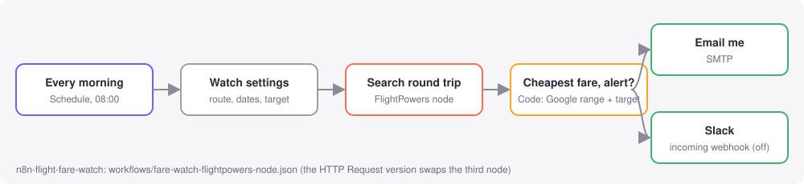

# n8n-flight-fare-watch

A daily flight fare watch you can import into [n8n](https://n8n.io) in one step: every morning it
prices your round trip with live Google Flights fares and emails you (or posts to Slack) when the
fare is under your target, under Google's usual range for the route, or rated `low` by Google.

No n8n? The same watch runs as a **GitHub Action** that opens an issue in your repo when there is a deal
(GitHub emails you about it), with nothing else to set up.



## What's inside

| File | What it is |
|---|---|
| [`workflows/fare-watch-flightpowers-node.json`](workflows/fare-watch-flightpowers-node.json) | n8n workflow using the [`n8n-nodes-flightpowers`](https://www.npmjs.com/package/n8n-nodes-flightpowers) node |
| [`workflows/fare-watch-http-request.json`](workflows/fare-watch-http-request.json) | the same workflow with n8n's built-in HTTP Request node (no community node needed) |
| [`github-action/`](github-action) | the same watch as a scheduled GitHub Action |

Both workflows: **Schedule (08:00)** -> **Watch settings** (route, dates, target, email) ->
**Search round trip** (one request: both legs priced together, one total, one booking link) ->
**Code** (cheapest fare + alert rules) -> **Email** and an optional **Slack** webhook (disabled until you
add your URL). On a day with no deal the Code node outputs nothing and no email goes out.

## Real example

With `target_price` set to 650, on a real JFK to Lisbon response fetched **2026-11-11 21:55 UTC**
(saved in [`recorded/`](recorded)), the email reads:

```text
Subject: Fare watch: JFK-LIS 628 USD (typical)

JFK -> LIS, 2027-02-01 to 2027-02-08: 628 USD round trip
Outbound: Tap Air Portugal | JetBlue, 0 stop(s), 10:00 PM on Mon, Feb 1
Return: Tap Air Portugal | JetBlue, 0 stop(s), 4:35 PM on Mon, Feb 8
Google: typical (usual 470-660 USD)
Why: at or under your target of 650
Book: https://www.google.com/travel/flights?tfs=GjsSCjIwMjctMDItMDEiHwoDSkZLEgoyMDI3LTAyLTAxGgNMSVMqAlRQMgMyMTBqBRIDSkZLcgUSA0xJUxo7EgoyMDI3LTAyLTA4Ih8KA0xJUxIKMjAyNy0wMi0wOBoDSkZLKgJUUDIDMjA5agUSA0xJU3IFEgNKRktCAQFIAZgBAQ&curr=usd
Fetched 2026-11-11 21:55 UTC. Fares change within minutes.
```

With the default target of 600 the same response sends nothing: $628 is over the target and Google calls it `typical`.

## Quick start in n8n (2 minutes)

1. **Get a key.** Open the [Google Flights Live API on RapidAPI](https://rapidapi.com/mtnrabi/api/google-flights-live-api),
   sign up and subscribe to the free **BASIC** plan (a small monthly request quota, no card). Copy your
   `X-RapidAPI-Key`.
2. **Import.** In n8n: **Workflows > Import from file** (or paste the JSON on the canvas).
   - FlightPowers node version: install the community node first (**Settings > Community nodes >
     Install > `n8n-nodes-flightpowers`**), then create a **FlightPowers API** credential with your
     RapidAPI key.
   - HTTP Request version: create a **Header Auth** credential with name `x-rapidapi-key` and your key as the value.
3. **Edit "Watch settings":** `from`, `to`, `departure_date` / `return_date` (by default 45 days from
   today for 7 nights, recalculated every run), `target_price`, `currency`, `email_to`.
4. **Connect email:** add your SMTP credential to **Email me** (or enable the **Slack** node and paste an
   [incoming webhook](https://api.slack.com/messaging/webhooks) URL).
5. **Execute workflow** once to test (set `always_send` to `true` to get a message even without a
   deal), then **Activate**.

One run is one request, so a daily watch uses about 30 requests a month (check the BASIC plan's monthly
quota on the pricing tab). To watch more routes, duplicate the workflow or turn "Watch settings" into a list;
for that, **PRO is $10 a month for 2,500 requests**.

## Quick start as a GitHub Action

1. Copy the `github-action/` folder into your repo, and
   [`github-action/fare-watch.yml`](github-action/fare-watch.yml) to `.github/workflows/fare-watch.yml`.
2. **Settings > Secrets and variables > Actions > New repository secret:** `RAPIDAPI_KEY`.
3. Edit `FROM`, `TO`, `DEPART` (or `DAYS_AHEAD`), `NIGHTS`, `TARGET_PRICE` in the workflow file.
4. Run it once from the **Actions** tab. Every run writes the fare to the job summary; a deal also opens an
   issue labelled `fare-alert`.

## The request

```bash
curl -X POST https://google-flights-live-api.p.rapidapi.com/api/google_flights/roundtrip/v1 \
  -H "Content-Type: application/json" \
  -H "x-rapidapi-host: google-flights-live-api.p.rapidapi.com" \
  -H "x-rapidapi-key: $RAPIDAPI_KEY" \
  -d '{"from_airport":"JFK","to_airport":"LIS","departure_date":"2027-02-01","return_date":"2027-02-08","currency":"usd","limit":10,"sort_type":"Price"}'
```

Each itinerary in the answer has `total_price_as_number`, both legs' airline, stops and times,
`buy_link`, and Google's `price_insights_low` / `price_insights_high` range with its
`price_range_in_relation_to_other_periods` verdict. Field reference:
[the API listing](https://rapidapi.com/mtnrabi/api/google-flights-live-api) and
[api.flightpowers.com/docs](https://api.flightpowers.com/docs). The HTTP version and the Action also
send `_fp_source` / `_fp_tool` so FlightPowers can count requests from this example; the API removes them
before the search, and you can delete them.

## Changing the alert rules

The Code node's source is [`src/pick-cheapest.js`](src/pick-cheapest.js). Edit it there and run
`node scripts/build.mjs` to write it into both workflow files.

## Tests

```bash
npm test                         # runs the Code node from each workflow on the recorded response
pip install pytest && pytest -q tests   # the GitHub Action script
```

## Related

- [flight-price-alert-bot](https://github.com/mtnrabi/flight-price-alert-bot): Telegram / Discord alerts for
  several routes.
- [cheapest-week-to-fly](https://github.com/mtnrabi/cheapest-week-to-fly): scan a date range and rank the
  cheapest round trips.
- [FlightPowers](https://flightpowers.com): the API behind these examples, also as an MCP server for Claude,
  Cursor and ChatGPT.

Not affiliated with Google, n8n or Slack. MIT licensed.
